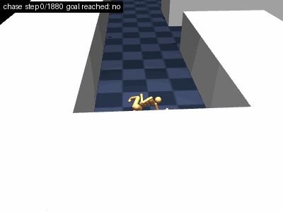
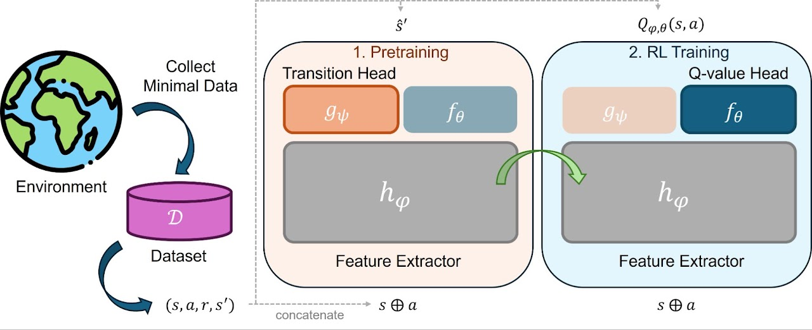

## About Me

I am an AI Robotics Engineer at NAVER LABS, working on robot learning, reinforcement learning (RL), and vision-language-action (VLA) models.

My research focuses on developing generalizable and data-efficient robot learning methods that leverage heterogeneous data across diverse physical embodiments. In In particular, I investigate data-efficient learning in both VLA models and reinforcement learning, exploring hierarchical architectures that leverage cross-embodiment data for generalizable high-level representations while learning embodiment-specific low-level policies. My experience includes developing RL-based controllers validated on real vehicles at Hyundai Motor Company and VLA models for real-world robots at NAVER LABS.

My long-term goal is to develop generalizable assistive robots that can perform complex, long-horizon tasks to support patients and older adults, leveraging humanoid whole-body control and dexterous manipulation.

---

## News

* **[2026.11]** Released our preprint, *"An Augmented Lagrangian Approach to Lifted Bellman Linear Programming"*, on arXiv.
* **[2026.09]** Released our preprint, *"Lifted Bellman Linear Programming for Offline Reinforcement Learning"*, on arXiv.
* **[2026.08]** Joined **NAVER LABS** as an AI Robotics Engineer (formerly at Hyundai Motor Company).
* **[2026.07]** My sole-authored paper, *"Scalable Reinforcement Learning via Adaptive Batch Scaling"*, was presented at **ICML 2026**!
* **[2025.12]** Our paper, *"Pretraining a Shared Q-Network for Data-Efficient Offline Reinforcement Learning"*, was presented at **NeurIPS 2025**!

---

## Publications
(*: equal contribution)

<!-- 1. ICML 2027 -->

  

    
  

  

**An Augmented Lagrangian Approach to Lifted Bellman Linear Programming**  
**Jongchan Park**, Hyukjun Yang\*, Narim Jeong\*, Donghwan Lee

  

<!-- 2. Lifted Bellman LP -->

  

  

  

**Lifted Bellman Linear Programming for Offline Reinforcement Learning**  
Hyukjun Yang, **Jongchan Park**\*, Narim Jeong\*, Donghwan Lee  
*Under Review*  
[Paper](https://arxiv.org/abs/2609.24489) | [Code](https://github.com/jundol32/QP-ALP)

  

<!-- 3. ICML 2026 -->

  

  

  

**Scalable Reinforcement Learning via Adaptive Batch Scaling**  
**Jongchan Park**  
*International Conference on Machine Learning (ICML)*, 2026  
[Paper](https://arxiv.org/abs/2605.21557) | [Code](https://github.com/daisophila/ABS)

  

<!-- 4. NeurIPS 2025 -->

  

    
  

  

**Pretraining a shared Q-network for data-efficient offline reinforcement learning**  
**Jongchan Park**\*, Mingyu Park\*, Donghwan Lee  
*Advances in Neural Information Processing Systems (NeurIPS)*, 2025  
[Paper](https://proceedings.neurips.cc/paper_files/paper/2025/hash/bd58c2ce8bcd01727ea3d060a6e297a5-Abstract-Conference.html) | [Code](https://github.com/daisophila/PSQN)

  

<!-- 5. IEEE Access 2025 -->

  

  

  

**Power consumption optimization of GPU server with offline reinforcement learning**  
Heechan Chung, Yeeun Im, **Jongchan Park**, Taeho Lee, Tae-Young Kim, Hyungjun Kim, Donghwan Lee  
*IEEE Access*, 2025  
[Paper](https://ieeexplore.ieee.org/abstract/document/11003853/)

  

---

## Work Experience

* **[NAVER LABS](https://www.naverlabs.com/en)** <align right>(Aug 2026 – Present)</align>  
  * **AI Robotics Engineer** / Robot Data Platform Team

* **[Hyundai Motor Company](https://www.hyundaimotorgroup.com/en/main/mainRecommend)** <align right>Jan 2025 – Aug 2026</align>  
  * **Research Engineer** / Vehicle Control Technology Development Team 2

---

## Education

* **Korea Advanced Institute of Science and Technology (KAIST)** <align right>(Aug 2023 – Feb 2025)</align>  
  * **M.S. in Electrical Engineering**
  * **Distinction**: Graduated One Semester Early  

* **Kookmin University (KMU)** <align right>(Mar 2018 – Feb 2023)</align>  
  * **B.S. in Mechanical Engineering**, Minor in Electrical Engineering
  * **Distinction**: Ranked 1st in the Department; Graduated One Semester Early
  * *Note*: Leave of absence for mandatory military service (Jul 2019 – Feb 2021)

---

## Honors & Awards

* **ICML Gold Reviewer Award** *(2026)*  
* **Hyundai Icon Award** *(2025)*  
* **Hyundai Motor Company Research Scholarship** *(2024)*  
* **Valedictorian (Highest Academic Honors)** *(2023)*  
* **Academic Excellence Scholarship** *(2021 – 2022)*  
* **Academic Excellence Scholarship** *(2018 – 2019)*  

---

## Services

* **International Conference Reviewer**:  
  * **[ICML]** Main Conference Reviewer *(2026)*  

* **Teaching Assistant**:  
  * **KAIST EE619**: Mathematical Foundations of Reinforcement Learning *(2024)*
 
* **Leadership**
  * **Lab Representative**: Reinforced Decision Intelligence Lab, KAIST *(2024)*

* **Community Service**:
  * **Volunteer Football Coach**: Saturday Class for People with Disabilities *(2026 - Present)*
